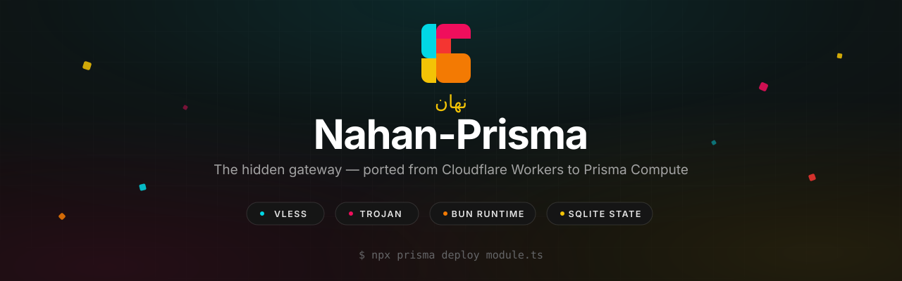
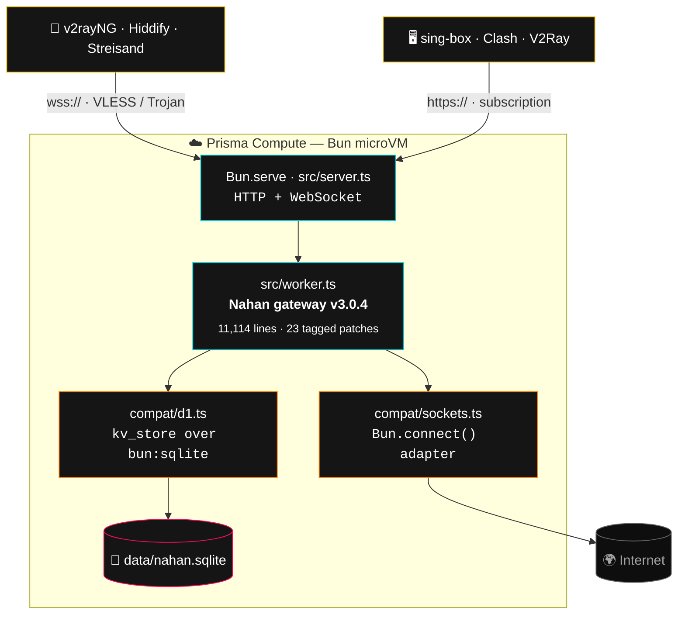

<p align="center">
  
</p>

<p align="center">
  <strong>نهان</strong> — Persian for <em>“hidden”</em>
</p>

<p align="center">
  <strong>Nahan-Prisma</strong> is the Nahan VLESS / Trojan gateway and subscription panel,<br/>
  ported from Cloudflare Workers to <a href="https://www.prisma.io/compute">Prisma Compute</a> — Bun on bare-metal microVMs.<br/>
  One command deploys it. No VPS, no server maintenance, no Cloudflare account.
</p>

<p align="center">
  <a href="https://github.com/mewshiam/Nahan-Prisma/actions/workflows/ci.yml"></a>
  <a href="LICENSE"></a>
  <a href="https://github.com/itsyebekhe/nahan"></a>
  <a href="https://bun.sh"></a>
  <a href="https://www.prisma.io/compute"></a>
  <a href="https://github.com/mewshiam/Nahan-Prisma/pulls"></a>
</p>

<p align="center">
  <a href="#-quick-start">Quick start</a> ·
  <a href="#%EF%B8%8F-deploy-to-prisma-compute">Deploy</a> ·
  <a href="#-documentation">Docs</a> ·
  <a href="#-architecture">Architecture</a> ·
  <a href="#-port-methodology">Port methodology</a> ·
  <a href="#%EF%B8%8F-faq">FAQ</a>
</p>

<p align="center" dir="rtl">
  <sub>دروازه‌ی مخفی — همین حالا روی Prisma Compute، بدون سرور و بدون دردسر</sub>
</p>

---

## ✨ Highlights

Everything that makes Nahan Nahan — shipped **verbatim** from upstream [v3.0.4](https://github.com/itsyebekhe/nahan), now running on Prisma Compute:

| | Feature | Notes |
|---|---|---|
| 🛡️ | **VLESS + Trojan over WebSocket** | Full protocol stack with `wss://` TLS |
| 🔗 | **Subscription links** | Base64 URI list, Clash YAML/JSON, sing-box, V2Ray — auto-negotiated by User-Agent |
| 👥 | **Multi-user profiles** | Per-user UUIDs, bandwidth caps, expiry dates, fake configs |
| 📊 | **Self-contained dashboard** | Single HTML panel with EN/FA UI, QR codes, activity logs |
| 🌍 | **Clean-IP & NAT64 multiplexing** | Relay health checks, quarantine, failover |
| 🤖 | **Telegram bot** | Manage the gateway from Telegram, unchanged |
| 🔗 | **Linked panels** | Multi-node federation via panel API keys |
| 💾 | **SQLite state** | The D1 adapter keeps the exact `kv_store` schema — zero migrations |
| 🧥 | **Camouflage** | Root path proxies to ubuntu.com / docker.com, identical to upstream |
| 🔁 | **Backup & restore** | One-click JSON export/import — also the migration path from Cloudflare |

## 🔀 Why this port exists

Upstream Nahan is brilliant — but it is welded to Cloudflare: Workers isolates, D1 bindings, Cron triggers, the Workers deploy API. This port re-platforms it onto [Prisma Compute](https://www.prisma.io/compute), Prisma's Bun-on-bare-metal app hosting, by replacing **only the platform seams** and touching none of the gateway logic:

| | Cloudflare Workers (upstream) | Prisma Compute (this port) |
|---|---|---|
| Runtime | V8 isolates, per-request lifecycle | Long-lived Bun process on bare-metal microVMs |
| Entry point | `export default { fetch }` | `Bun.serve()` HTTP + WebSocket server |
| TCP dialing | `cloudflare:sockets` `connect()` | `Bun.connect()` via a byte-compatible adapter |
| WebSocket tunnels | `WebSocketPair` + `Response(101)` | `server.upgrade()` + tunnel state machine |
| Persistent state | D1 SQLite binding (`env.IOT_DB`) | Local SQLite file via `bun:sqlite` (D1-compatible API) |
| Scheduled jobs | Cron triggers → `scheduled()` | `setInterval` → same `handleScheduled()` |
| Code deploys | In-panel self-update via CF API | `npx prisma deploy module.ts` (CLI / GitHub push) |
| Camouflage | Proxy to ubuntu.com / docker.com | Identical (outbound `fetch` works the same) |

## 🏗️ Architecture



A request enters `Bun.serve`, is handed to the ported worker's `handleFetch`, and from there the flow is byte-for-byte upstream: route check → auth → subscription render **or** WS upgrade → VLESS/Trojan parse → `connect()` adapter → bidirectional TCP piping. The deep-dive with sequence diagrams lives in [`docs/architecture.md`](docs/architecture.md).

## 🚀 Quick start

Runs anywhere Bun ≥ 1.1 runs — your laptop included:

```bash
git clone https://github.com/mewshiam/Nahan-Prisma.git
cd Nahan-Prisma
bun install
bun run start        # listens on :3000 (or $PORT)
```

| URL | What |
|---|---|
| `http://localhost:3000/sync/dash` | Dashboard — default route, **change it after first login** |
| `http://localhost:3000/sync` | Subscription endpoint (`?sub=<user>` for multi-user) |
| `http://localhost:3000/` | Camouflage — proxies to the maintenance host |

> ⚠️ First login uses the default master key `admin`. **Immediately** open the **System** tab, rotate the master key, and set a secret API route. The gateway is internet-facing the moment it boots.

## ☁️ Deploy to Prisma Compute

Full walkthrough in [`deploy/README.md`](deploy/README.md). The short version:

```bash
npx prisma auth login          # once — opens a browser
bun install
bun run deploy                 # build + provision via module.ts
```

You get a live `*.prisma.app` URL with TLS. State persists in a SQLite file inside the deployment (`DATA_DIR`, default `./data`) — the dashboard's built-in backup/restore works unchanged, and it's also how you move between installs.

## 📚 Documentation

| Doc | What's inside |
|---|---|
| [`deploy/README.md`](deploy/README.md) | Step-by-step Prisma Compute deployment, first-time config, TLS & custom domains |
| [`docs/architecture.md`](docs/architecture.md) | Request lifecycle, tunnel sequence diagrams, the compat layer, patch catalogue |
| [`docs/migration-from-cloudflare.md`](docs/migration-from-cloudflare.md) | Move an existing upstream (Cloudflare) install over — backup, deploy, restore |
| [`docs/client-setup.md`](docs/client-setup.md) | Connecting v2rayNG, Hiddify, sing-box, Streisand, Clash to your gateway |
| [`docs/self-hosting.md`](docs/self-hosting.md) | Running on any other Bun host — VPS, Docker, systemd, reverse proxies |
| [`CHANGELOG.md`](CHANGELOG.md) | Release history |

## 📁 Repository layout

```
├── module.ts               # Prisma Compute deploy module (root entry)
├── prisma.config.ts        # Prisma CLI config: composer + prismaCloud + nodeBuild
├── src/
│   ├── index.ts            # standalone entry (bun run start)
│   ├── compute.ts          # Prisma Compute entry (service.port())
│   ├── service.ts          # Prisma Compute service definition
│   ├── server.ts           # Bun.serve wiring: HTTP fetch + WS tunnel handlers
│   ├── worker.ts           # THE PORT — upstream _worker.js v3.0.4, 23 tagged patches
│   ├── compat/
│   │   ├── d1.ts           # D1 → bun:sqlite adapter (identical prepare/bind/all/run API)
│   │   ├── sockets.ts      # cloudflare:sockets → Bun.connect (opened/readable/writable/close)
│   │   └── runtime.ts      # env/ctx shims, page asset resolution, client IP mapping
│   └── pages/
│       ├── dashboard.html  # upstream dashboard + 5 Prisma adaptations
│       └── subscription.html
├── site/                   # Prisma.io-styled landing page (Next.js)
├── tests/
│   ├── build-port.js       # regenerates src/worker.ts from upstream _worker.js
│   ├── patch-dashboard.js  # re-applies the dashboard adaptations
│   ├── test-connect-adapter.ts
│   ├── test-vless-tunnel.ts
│   └── test-trojan-tunnel.ts
├── docs/                   # guides + brand assets
└── deploy/README.md        # deployment guide
```

## 🔧 Port methodology

`src/worker.ts` is a **verbatim mechanical port** of upstream `_worker.js` — 11,114 lines of battle-tested gateway logic, intentionally kept as a single file so diffs against upstream stay reviewable and future upstream merges stay mechanical. Every deviation is tagged with a `PORT NOTE` comment and registered in `tests/build-port.js`, which regenerates the port from a checkout of upstream and **fails loudly on drift**:

```bash
git clone https://github.com/itsyebekhe/nahan reference/nahan
bun tests/build-port.js     # applies the 23 patches
```

| Tag | Patch |
|---|---|
| **P1** | `cloudflare:sockets` import → `src/compat/sockets.ts` (Bun.connect) |
| **P2** | `fetchT` learned `file://` so bundled pages load from the deployment image |
| **P3** | `export default {fetch, scheduled}` → exported `handleFetch` / `handleScheduled` |
| **P4** | `cf-connecting-ip` header reads → `clientIpOf()` (x-forwarded-for / socket addr) |
| **P5** | `request.cf` geo metadata → dropped (Cloudflare-only) |
| **P6** | Dashboard/subscription fallback URLs → this repository |
| **P8/P9** | `WebSocketPair` + `Response(101)` → `server.upgrade()` |
| **P10** | `startDataPipe` → `createTunnel()` with `onMessage`/`onClose` (Bun WS events) |
| **P11** | `deployWorkerToCloudflare` throws a descriptive error — on Prisma Compute you ship code with `npx prisma deploy`, not the Workers API |
| **P12** | `// @ts-nocheck` pragma — upstream is untyped JS carried verbatim; `tsc` validates the port-owned code instead |

The byte-level WS semantics are preserved exactly: Cloudflare delivered tunnel frames as `ArrayBuffer` (`binaryType="arraybuffer"`), so the Bun entry point normalizes each frame to a real `ArrayBuffer` before it reaches the protocol parser.

## 🧪 Tests

Verified on Bun 1.3.14 — and on every push, by [CI](.github/workflows/ci.yml):

- `test-connect-adapter.ts` — TCP adapter unit test (echo round-trip)
- `test-vless-tunnel.ts` — full VLESS path: WS upgrade → header parse → UUID lookup → TCP connect → bidirectional piping → multi-frame streaming
- `test-trojan-tunnel.ts` — Trojan branch: sha224 handshake → CRLF framing → echo
- Manual: master-key rotation + multi-user profiles persisted in SQLite across restarts; camouflage proxy; subscription formats

```bash
bun tests/test-connect-adapter.ts
PORT=8977 bun run src/index.ts &     # tunnel tests need a live gateway
bun tests/test-vless-tunnel.ts
bun tests/test-trojan-tunnel.ts
```

## ⚖️ Platform differences to know

- **In-panel self-update is disabled.** Code deploys go through the Prisma CLI (`npx prisma deploy`) or a connected GitHub repo. The dashboard's update tab still reports availability; applying it is a deploy, not a click.
- **`request.cf` geo fields** (country/city/ASN in login alerts) are Cloudflare-only and render as “Unknown” on Prisma Compute.
- **Cloudflare Analytics usage widget** still works if you fill the (legacy) Cloudflare API fields — otherwise ignore that section.
- **D1 → SQLite**: same schema (`kv_store` key/value), zero migration needed for new installs. Nahan's built-in JSON backup/restore moves state between installs.
- **No daily request cap** like the Workers free plan's 100k/day — Prisma Compute pricing is operation-based with spend limits.

## ❓ FAQ

<details>
<summary><strong>Is this a fork of Nahan?</strong></summary>

No — it's a <em>platform port</em>. The gateway itself is upstream v3.0.4, carried over verbatim through 22 reviewable, tagged patches (see <a href="#-port-methodology">port methodology</a>). Only the platform seams — sockets, storage, WebSockets, entry point — were adapted. When upstream ships a new version, the port regenerates mechanically.
</details>

<details>
<summary><strong>I already run Nahan on Cloudflare. How do I move over?</strong></summary>

Dashboard → <strong>Backup</strong> → export JSON → deploy this port → <strong>Restore</strong>. Users, UUIDs, volume keys and settings all come across. The step-by-step is in <a href="docs/migration-from-cloudflare.md">docs/migration-from-cloudflare.md</a>.
</details>

<details>
<summary><strong>Can I self-host somewhere other than Prisma Compute?</strong></summary>

Yes — anything that runs Bun ≥ 1.1 works: a VPS, Docker, even your laptop. <a href="docs/self-hosting.md">docs/self-hosting.md</a> covers systemd units, Dockerfiles, and reverse-proxy TLS.
</details>

<details>
<summary><strong>Why “Nahan”?</strong></summary>

<code>نهان</code> (nahan) is Persian for <em>hidden</em> / <em>concealed</em>. The project is built for the Iranian community first — the dashboard ships with a full Persian UI — and this port keeps that heritage.
</details>

<details>
<summary><strong>What does it cost?</strong></summary>

The software is free (MIT). Prisma Compute has a free tier with operation-based pricing and spend limits after that; running it on your own box costs nothing but the box.
</details>

## 🤝 Credits & license

- **[itsyebekhe/nahan](https://github.com/itsyebekhe/nahan)** — the gateway itself. All credit for the protocol work, dashboard and design belongs to the Nahan community (MIT).
- **[ImLTHQ/edgetunnel](https://github.com/ImLTHQ/edgetunnel)** — the lineage Nahan forked from.
- **[Prisma](https://www.prisma.io/)** — the Compute platform this port targets, and the inspiration for the visual language of this repository.

MIT — same as upstream. See [LICENSE](LICENSE).

<p align="center">
  <sub>Built as a platform port, with respect for the original.</sub><br/>
  <a href="https://github.com/mewshiam/Nahan-Prisma/stargazers">
    
  </a>
</p>
