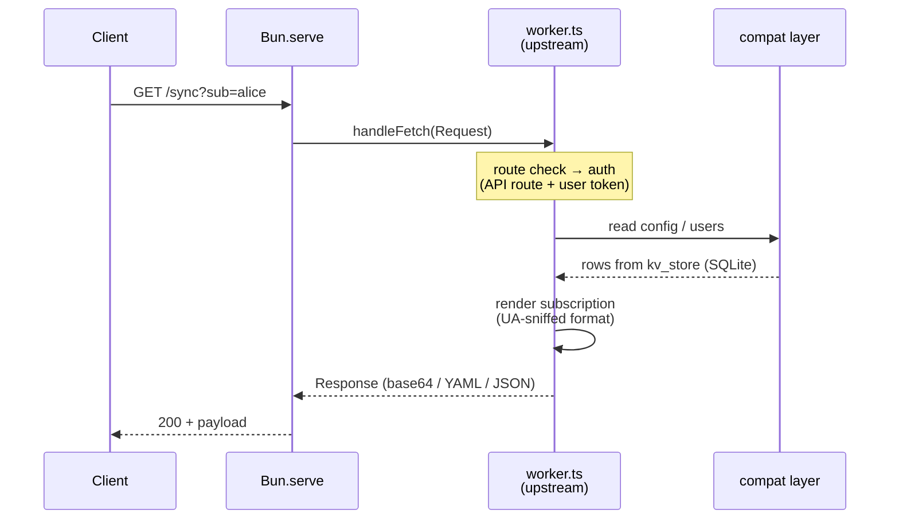
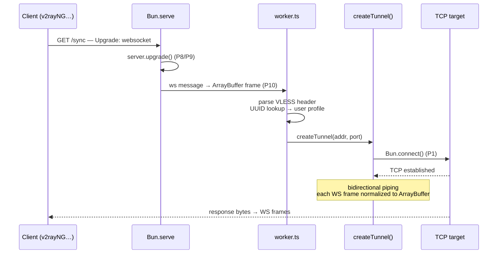

# Architecture

How the Nahan gateway runs on Prisma Compute — the entry chain, the request lifecycle, the tunnel data path, and the compatibility layer that makes upstream code believe it is still on Cloudflare.

## The big picture

```
module.ts                Prisma Compute deploy module — provisions the service
  └─ src/service.ts      service definition (name, build, start)
       └─ src/compute.ts platform entry — reads PORT, wires service.port()
            └─ src/server.ts   Bun.serve: fetch handler + websocket handlers
                 └─ src/worker.ts   upstream Nahan v3.0.4 + 23 PORT NOTE patches
                      ├─ src/compat/sockets.ts   connect() over Bun.connect
                      ├─ src/compat/d1.ts        D1 API over bun:sqlite
                      └─ src/compat/runtime.ts   env/ctx shims, page assets, client IP
```

Two properties are load-bearing in this design:

1. **Upstream stays verbatim.** All 11,114 lines of gateway logic live in one file, `src/worker.ts`. Every deviation from upstream is a tagged, numbered patch applied by `tests/build-port.js`. When upstream releases v3.0.5, the port is a re-run of the patch script plus whatever new seams that release introduced — not a re-write.
2. **Adapters mimic, not abstract.** The compat layer doesn't wrap Cloudflare APIs behind new interfaces; it re-creates the same API surface (`connect()`, `prepare().bind().all()`, …) on Bun primitives. That's why the worker file needs so few patches.

## Request lifecycle (HTTP)



A plain HTTP request never touches the tunnel path. It goes through the same `handleFetch` the upstream worker exported — patched only in how the `Request` was constructed (P3) and how the client IP is resolved (P4).

## Tunnel lifecycle (VLESS over WebSocket)



Cloudflare delivered every WebSocket frame as an `ArrayBuffer` because the worker set `binaryType = "arraybuffer"` on its side of the pair. Bun hands handlers `Uint8Array`s (and different views of the same buffer). To keep the upstream parser byte-identical, `src/server.ts` normalizes each incoming frame to a **real** `ArrayBuffer` copy before the worker ever sees it. Frames flowing back are wrapped the same way the upstream `startDataPipe` did.

The Trojan branch is the same shape with a different handshake — sha224 password check, CRLF-framed target address instead of the VLESS binary header — and is covered by its own test.

## The compatibility layer

### `compat/sockets.ts` — `cloudflare:sockets` → `Bun.connect`

Upstream calls `connect(address)` from the `cloudflare:sockets` module and consumes the returned socket as Web streams. The adapter preserves that surface exactly:

| Upstream API | Adapter behavior |
|---|---|
| `connect({hostname, port})` | Returns a handle synchronously (like CF), dials via `Bun.connect` in the background |
| `socket.opened` | Promise that resolves when the TCP connection is established |
| `socket.readable` / `socket.writable` | Web `ReadableStream` / `WritableStream` views over the Bun socket |
| `socket.close()` / `socket.startTls()` | `close()` half-closes cleanly; `startTls()` throws — never used by Nahan |

`tests/test-connect-adapter.ts` round-trips an echo server through this API to prove stream parity.

### `compat/d1.ts` — D1 → `bun:sqlite`

Nahan's schema is a single key-value table, so the adapter only re-creates the calls it actually makes — but with D1's exact shapes:

| D1 API | Adapter behavior |
|---|---|
| `db.prepare(sql)` | Wraps a `bun:sqlite` statement |
| `stmt.bind(...params)` | Queues positional params |
| `stmt.first()` / `stmt.all()` / `stmt.run()` | Execute and map rows; `run()` returns `{ success, meta }` like D1 |
| `db.batch([...])` | Sequential execution in a transaction |

The on-disk file (`$DATA_DIR/nahan.sqlite`, default `./data`) uses the identical `kv_store` table and key layout as a D1 install, which is why JSON backups restore cleanly across platforms.

### `compat/runtime.ts` — environment shims

- **`env`** — exposes `IOT_DB` (the D1 adapter) and deployment variables, mimicking Workers bindings.
- **`ctx`** — `waitUntil` maps to fire-and-forget tracking (a long-lived Bun process has no per-request isolate to keep alive).
- **Page assets** — the dashboard and subscription pages resolve via `fetchT("file://…")` (P2) so they ship inside the deployment image instead of being fetched from GitHub raw at runtime.
- **`clientIpOf()`** — upstream read `cf-connecting-ip`, a header Cloudflare injects. Behind Bun there is no such header, so the shim falls back to `x-forwarded-for` (when a proxy is in front) or the socket's remote address (P4).

## State model

All state is JSON documents in the `kv_store` table: system configuration under `sys_config`, user profiles, per-user usage counters, relay health, activity log. On Cloudflare that table lived in D1; here it lives in a SQLite file owned by the deployment. Nothing else is persistent — the process is otherwise stateless, which is why reprovisioning plus a JSON restore is a complete, faithful migration.

## Scheduled work

Upstream relied on Cron triggers calling `scheduled()`. A long-lived Bun process doesn't need the platform for that: `src/server.ts` runs the same `handleScheduled()` on a 5-minute `setInterval` (relay probes, quarantine sweeps, usage housekeeping). No patch to the handler itself was needed — only the trigger moved.

## Testing strategy

| Test | Proves |
|---|---|
| `test-connect-adapter.ts` | The TCP adapter's stream semantics match `cloudflare:sockets` |
| `test-vless-tunnel.ts` | Full VLESS path incl. multi-frame streaming and relay failover |
| `test-trojan-tunnel.ts` | Trojan handshake and CRLF framing |
| `tests/build-port.js` | The port can be regenerated from upstream — drift is loud, not silent |

CI runs all four on every push (see [`.github/workflows/ci.yml`](../.github/workflows/ci.yml)): the adapter test standalone, then a gateway instance is booted on `:8977` for the two tunnel tests to dial into.
